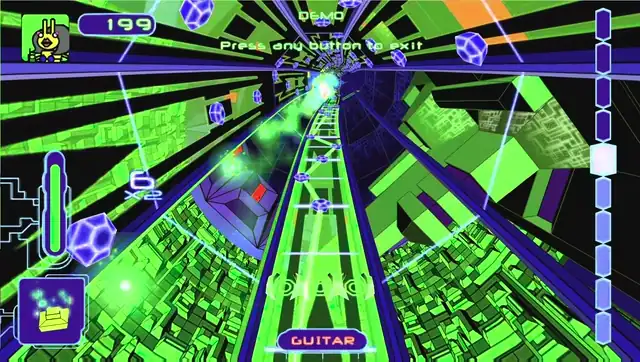
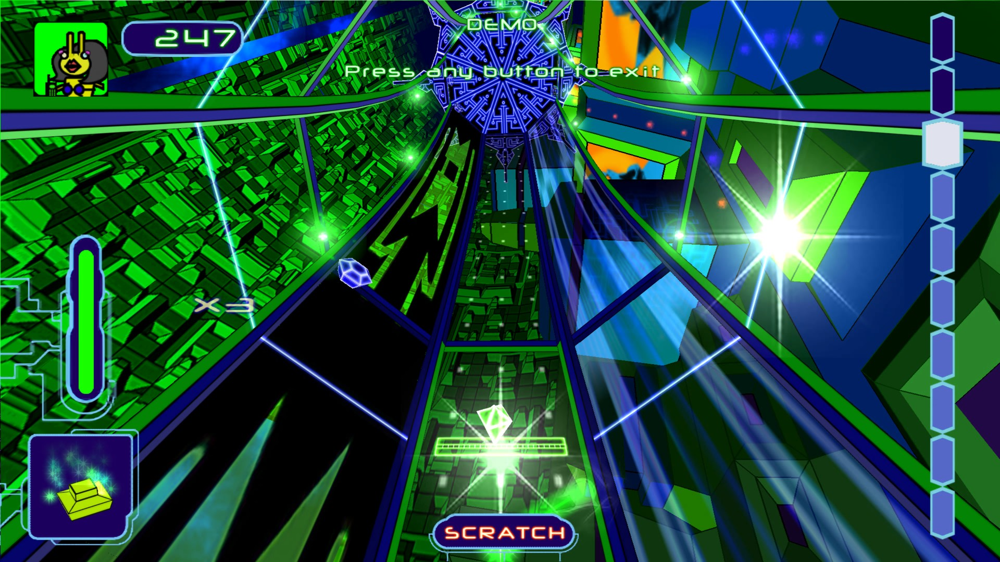
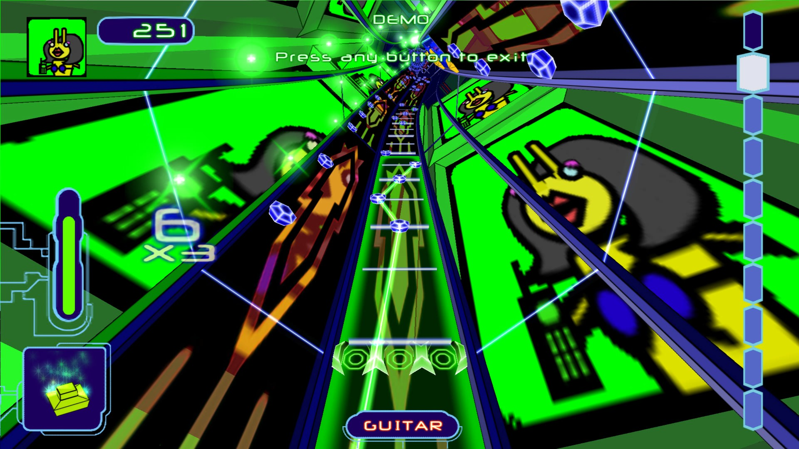
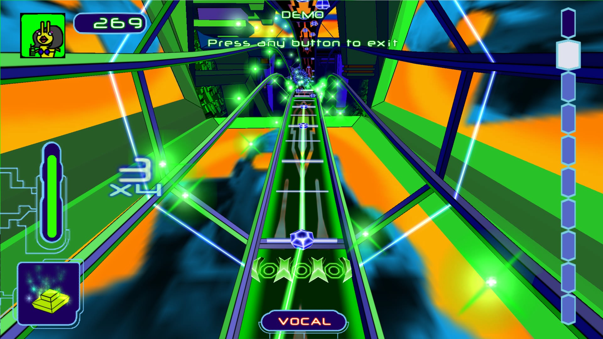
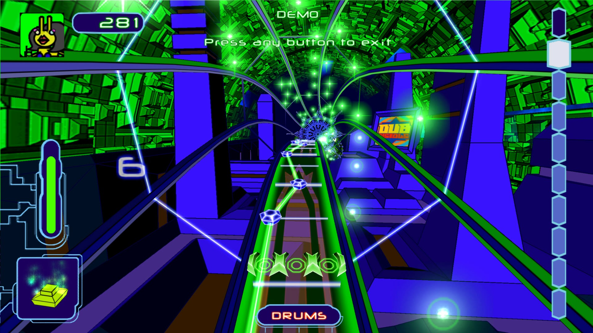

# Frequency Remaster

<!-- WISWA-GENERATED-README:START -->

[](https://github.com/thesmokesession-bit/frequency-remaster/releases/latest)
[](https://github.com/thesmokesession-bit/frequency-remaster/releases)
[](LICENSE.txt)
[](#installing-on-a-ps5)
[](#linux)
[](https://isocpp.org)

<!-- WISWA-GENERATED-README:STOP -->

[](docs/media/preview.mp4)

_FreQuency_, the 2001 PlayStation 2 rhythm game by Harmonix, rebuilt as a native PS5 and Linux game
in 4K at up to 120 frames a second. Select the preview above for a 41-second video recorded on a
PS5.

The game is not emulated. The [resonance](https://github.com/Tatsh/resonance) project reconstructed
its code as C and C++ from the original executable. This fork compiles the reconstructed code for
x86-64, runs it on a PS5 or a Linux PC, and adds the features below. The two PS2 chips the game
draws and plays sound with (the Graphics Synthesizer with its VU1 microcode, and the SPU2) are
recreated with code from the Play! emulator and drawn through Vulkan on the PS5.

Releases include no game data. You need your own copy of _FreQuency_ (USA), SCUS-97125.

## Highlights

- 4K at up to six times the PS2's resolution, 120 frames a second on a 120 Hz TV, and 16:9
  widescreen with the HUD at the screen edges.
- A cleaner picture than the PS2 (16x anisotropic filtering of the game's mip levels, 8 bits a
  colour channel in place of 5, and optional FXAA, bloom, and CRT filters).
- 5.1 surround with a spatial mix that plays each instrument from its lane in the tunnel.
- DualSense support with the light bar in your player colour on the beat, adaptive-trigger clicks,
  and beat rumble.
- Free online play for up to 4 players on 4 machines, with a three-word room code and no account.
- Local play for up to 4 players with a controller each.
- Practice mode with slow-down at the same pitch and bar or phrase loops, plus no-fail, a wider
  timing window, unlock all, and a watch mode that plays every song by itself.
- Two finished songs that are on the disc but never appear in the game (BT's _Godspeed_ and Kareem
  Caines' _Scratchotronic_), now playable.
- Replays of your best runs with a ghost score, 25 achievements, and a friends scoreboard.
- An in-game settings page with 34 settings in 7 sections, and signed automatic updates.

## Screenshots

Captured on a PS5 at 4K and shown here at 1080p.

| Scratch track                            | Guitar track                           |
| ---------------------------------------- | -------------------------------------- |
|  |  |
| **Vocal track**                          | **Drum track**                         |
|      |     |

## Requirements

- A PS5 with a homebrew setup that installs titles from `/data/homebrew`, and an FTP server on the
  console. The remaster is tested on firmware 13.60 with etaHEN.
- An ISO image of your copy of _FreQuency_ (USA), SCUS-97125, with 2048-byte sectors.

A raw CD dump (a `.bin` with a `.cue`) converts to an ISO by copying the 2048 data bytes out of
each 2352-byte sector:

```shell
python3 -c "import sys;f=open(sys.argv[1],'rb');o=open(sys.argv[2],'wb');[o.write(s[24:2072]) for s in iter(lambda:f.read(2352),b'')]" 'Frequency (USA).bin' 'Frequency (USA).iso'
```

## Installing on a PS5

1. Download `Frequency-PS5-<version>.zip` from the
   [latest release](https://github.com/thesmokesession-bit/frequency-remaster/releases/latest) and
   unzip it. The zip has a single `PPSA64010` folder.
2. Put your ISO in the `PPSA64010` folder. Any file name works. The game uses the first `.iso`
   file in the folder.
3. Copy the `PPSA64010` folder to `/data/homebrew/` on the PS5 with an FTP client.
4. Let your homebrew installer register the title, then start _Frequency_ from the home screen.

Saves go to `memcard/` in the title folder, and settings go to `frequency.ini` beside it.
`frequency.ini.example` in the zip documents every setting.

## Updating

Each start of the game checks this repository for a newer build. When one exists, the game
downloads it and installs it for the next start. The UPDATE setting in the SYSTEM section of the
settings page turns the check off.

The updater installs a build only when its `eboot.bin.sig` is a valid Ed25519 signature from the
release key. The private key is not stored on GitHub, and a stolen GitHub login cannot put code on a
console.

To update by hand, copy `eboot.bin` from the new release over
`/data/homebrew/PPSA64010/eboot.bin`, or copy the `PPSA64010` folder from the new zip over the old
one. The zip has no `frequency.ini`, memory card, replays, or logs, and copying it does not replace
yours.

To check a download yourself with OpenSSL 3, save the release key as `frequency-update.pub`:

```text
-----BEGIN PUBLIC KEY-----
MCowBQYDK2VwAyEAIapu1iWrYMbt3onNPZw6TLA/zE3ZqIGfxJQ7dpvoT1c=
-----END PUBLIC KEY-----
```

Then verify `eboot.bin` against `eboot.bin.sig`. The last command prints
`Signature Verified Successfully` for a genuine build.

```shell
openssl dgst -sha256 -binary eboot.bin > eboot.sha256
openssl pkeyutl -verify -pubin -inkey frequency-update.pub -rawin -in eboot.sha256 -sigfile eboot.bin.sig
```

## Features

Every feature has a line in `frequency.ini`, and most are also on the settings page.

### Picture

- Resolution from 1 to 6 times the PS2's. The PS5 default matches the TV's lines (5 on a 4K TV).
- 60 or 120 frames a second. 120 needs a TV that runs at 120 Hz.
- 16:9 widescreen, with the HUD moved to the screen edges if you want it there.
- Enhanced texture filtering (the default) draws the game's mip levels with 16x anisotropic
  filtering, with no shimmer on far tunnel walls. Original filtering uses the top level only, as
  the PS2 did.
- Full colour depth (the default) gives 16-bit pictures 8 bits a channel, with no banding in glows
  and trails. Original colour depth uses 5 bits, as the PS2 stores them.
- Lines, points, and the feedback blur scale with the resolution, or stay one pixel wide for a
  sharper look.
- FXAA anti-aliasing, and a bloom or CRT filter over the finished frame.
- Replacement HD textures from the `hd` folder in the title folder.

### Sound

- 5.1 surround on an output that supports it, otherwise stereo.
- A spatial mix that plays each instrument from its lane in the tunnel, with your current track in
  front and the others around you, turning as you change tracks.
- Sample playback with gaussian (the console's), linear, cubic, or 8-tap sinc interpolation.

### Timing

- Audio, video, and input offsets from -250 to 250 ms in 5 ms steps.
- A calibration on the Game Options screen (press Square, then tap any button with the 12 clicks)
  that sets the input offset.
- To line up a TV, play a song and move VIDEO OFFSET until the gems arrive at the catcher on the
  beat you hear.

### Controller

- The DualSense light bar shows each player's colour, pulses on the beat, and flashes when you
  capture a section.
- L2 and R2 click at their press point through the adaptive triggers.
- Beat rumble with an adjustable lead of 0 to 180 ms for motors that respond late.
- A song pauses itself when a controller disconnects, when the PS button or a system overlay covers
  the game, and when the console wakes from rest mode.

### Gameplay

- Practice mode turns every song into a practice run with no energy drain and no score saved.
  Select restarts the song at once.
- Practice at 50 to 100 percent speed at the same pitch, and loop a range of bars or phrases.
- No fail, and a timing window of 1.5 or 2 times the original.
- Unlock all opens every arena and stage from the start. Unlike the game's cheat, progress and high
  scores still save.
- Watch mode plays every song perfectly by itself, as a jukebox or a demo for guests.
- BT's _Godspeed_ and Kareem Caines' _Scratchotronic_ play as a sixth song of stages 4 and 1. They
  open with the secret songs.
- Custom songs from the `songs` folder replace or add to the disc's songs without changing the ISO.
  `host/io/songs.py` unpacks a disc song into a song folder and lists the files a new song needs.
- Fast boot skips the memory card wait, the Sony screen fades, and the intro movie from the second
  start.

### Scores and replays

- Every solo song is recorded, and a new high score stores the run in `replays/`. Square on the
  results screen plays the run back.
- The ghost shows the stored run's score at the same point of the song, under yours.
- 25 achievements, each with a console notification. `achievements.txt` in the title folder lists
  them.
- A friends board shares each machine's best score per song with every machine that sets the same
  board code (Multiplayer > SCOREBOARD). A notification shows your rank after each new best.

### Accessibility

- Player colours that stay distinct with red-green colour blindness, on the gems, the catcher, the
  lanes, and the HUD.
- The white flash of each caught gem at full strength, half strength, or off.
- Motion trails at full strength, half strength, or off.

### Photo mode

Pause a song and click the touchpad (or R3). The left stick orbits the camera, the right stick
zooms, Cross saves a PNG to `photos/` in the title folder, and Circle or the touchpad returns to
the pause menu.

## Multiplayer

### Local

Up to 4 players can play on one console with a controller each. Pick Multiplayer in the main menu.

### Online

Online play connects up to 4 players on up to 4 machines, with no account and no paid server.

1. Every player opens Multiplayer > ONLINE.
2. One player picks HOST, and the others pick JOIN.
3. Everybody enters the same code of three words. Up and Down move between the words, Left and
   Right change a word, and L1 and R1 jump to the previous or next letter.

The songs the host starts in Solo or Multiplayer start on every machine in the room, and each guest
plays one player with its first controller. Remixes and the tutorial are not shared. The console
shows a notification when a machine joins or departs.

The machines meet through [ntfy.sh](https://ntfy.sh), with every post signed with the room code,
and then play directly over UDP port 47125. Most home routers need no change. If the machines fail
to connect, forward port 47125 on the host's router to the host. A machine with the code can join
the room, and the words should be hard to guess.

## Settings page

Open Options > Game Options and press Circle. The page lists 34 settings in 7 sections (DISPLAY,
SOUND, TIMING, CONTROLLER, GAMEPLAY, ACCESSIBILITY, and SYSTEM).

- Up and Down pick a setting, and L1 and R1 jump to the previous or next section.
- Left and Right change the setting and save it to `frequency.ini` at once.
- Circle or Triangle closes the page.

The panel under the list explains the setting and shows whether a change applies from the next song
or the next start.

## Troubleshooting

- `frequency.log` in the title folder is the log of the current run. Each start moves the last
  run's log to `logs/`.
- A crash writes `logs/crash-<date>-<time>.txt` with the build, the signal, the registers and stack,
  and the end of the log. The next start shows a notification.
- SEND REPORT in the SYSTEM section sends the last crash report, or the current log, to your
  [ntfy](https://ntfy.sh) topic, with tokens, keys, room codes, and board codes removed. The topic
  is `FREQ_REPORT_TOPIC` in `frequency.ini`. Open `https://ntfy.sh/<topic>` within 12 hours to read
  the report.

To report a problem,
[open an issue](https://github.com/thesmokesession-bit/frequency-remaster/issues) with the log or
crash report and a description of what you pressed.

## How the remaster works

- `src/` is the game, reconstructed function by function from the PS2 executable by the resonance
  project. Song charts, scoring, the tunnel, and the menus run as the original code does.
- `sce/` reconstructs the Sony library routines the game calls.
- `host/` replaces the PS2 under the game with native code. It covers the kernel and the IOP
  modules, the controllers, the disc and memory card, the movies (FFmpeg), the network, and the
  settings.
- `host/gfx/ps2gfx` and `host/audio/play` recreate the Graphics Synthesizer, VU1, and SPU2 with
  code from Play!. The PS5 draws through Mesa's RADV Vulkan driver, with a patch for 119.88 Hz
  video out.
- `host/ps5` is the PS5 layer (the title folder, DualSense features, notifications, and the signed
  updater with curl and OpenSSL 3.5.9).

## Building

### Linux

The native build needs CMake, Ninja, a C++ compiler, SDL2, OpenGL, zlib, libpng, FFmpeg's
libavcodec and libavutil, libcurl, and OpenSSL's libcrypto.

```shell
cmake -B build -G Ninja -DRESONANCE_HOST=ON -DRESONANCE_PS2GFX=ON -DCMAKE_BUILD_TYPE=Release
cmake --build build
cp host/frequency.ini.example frequency.ini
FREQ_DISC='Frequency (USA).iso' build/host/resonance_host
```

`-DPS2GFX_VULKAN=ON` adds the Vulkan renderer, selected with `FREQ_GFX=vulkan`.

### PS5

`host/ps5/build.sh package` builds the title folder in `out/PPSA64010`. The build runs in Perfect
Eye's build container with the PS5 payload SDK, RADV built for the PS5, the PacBrew sysroot, and
OpenSSL 3.5.9. The comment at the top of `host/ps5/build.sh` documents each step.

### PlayStation 2

The original PS2 build uses the ps2dev cross compilers for the Emotion Engine and the IOP, their C
and C++ runtime, and the IRX fixup tool. It does not use ps2sdk. Every Sony library routine the game
calls is reconstructed under `sce/`, and `sce/ee/runtime` connects the compiler's runtime to the
reconstructed kernel.

```shell
cmake -B build -G Ninja -DCMAKE_TOOLCHAIN_FILE=cmake/ps2-ee-toolchain.cmake -DRESONANCE_DISC_IMAGE=/path/to/FreQuency.cue
cmake --build build --target image
```

The `image` target writes `build/resonance.cue` and `build/resonance.bin`, a raw Mode 2 CD image
like the original disc, with the built executable and EZMIDI.IRX in place of the originals. The
original may be a cue, a bin, or an ISO. Without `RESONANCE_DISC_IMAGE`, the build produces the
executable and the module only.

`RESONANCE_DISC_IMAGE` may also be the disc root, the directory with `SYSTEM.CNF`. A copy of the
disc files lacks the boot logo that the original disc stores in its first 12 sectors. A console may
refuse a disc without the boot logo. Set `RESONANCE_DISC_SYSTEM_AREA` to a file with the 24576
bytes of the first 12 sectors of the original disc to include the boot logo.

## Credits

- Andrew Udvare and the [resonance](https://github.com/Tatsh/resonance) project for the
  decompilation that every part of the remaster builds on.
- Jean-Philip Desjardins and the contributors of Play! for the Graphics Synthesizer, VU, and SPU2
  code.
- The developers of the PS5 payload SDK, Mesa's RADV driver, PacBrew, and etaHEN.
- Harmonix Music Systems for _FreQuency_.

## Licences

- The project's code is under the MIT licence in `LICENSE.txt`.
- The Play! code in `host/gfx/ps2gfx` and `host/audio/play` is under its BSD licence
  (`LICENSE.Play.txt` in each folder).
- Python 2.0 and gzip 1.2.4 under `3rdparty/` remain under their licences.
- The PS5 `eboot.bin` links FFmpeg (LGPL), x264 (GPL), OpenSSL (Apache 2.0), curl (curl licence),
  and Mesa's RADV (MIT). The source of each build is this repository at the commit its release
  notes record.

## Provenance

This is an independent reverse-engineering effort for preservation and study. It includes no code
and no assets copied from the game. _FreQuency_ and its assets remain the property of their
respective rights holders, and this project is not affiliated with or endorsed by Harmonix or Sony
Interactive Entertainment.
